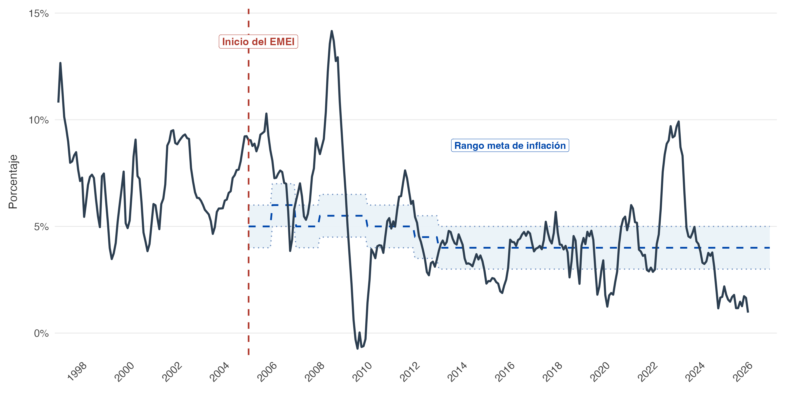
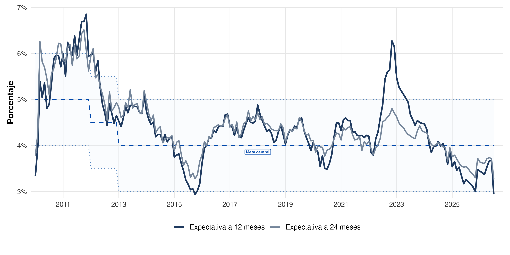

## ¿Vender más quetzales significa ganar más? {.section-slide}

Maestría en Formulación y Evaluación de Proyectos

Una planta de alimentos aumenta sus ventas de **Q3.0 a Q3.3 millones**.

Sus insumos suben 15%. El banco revisa la tasa del préstamo.

**¿Aprobarían la inversión con la misma evaluación financiera?**

::: {.notes}
Votación inicial: sí, no, faltan datos. Solicitar una razón por respuesta. No resolver todavía. Supuestos académicos, no cifras de una empresa real.
:::

## Lo que podremos decidir al terminar

- Distinguir dinero, crédito y medios de pago.
- Explicar cómo dinero, precios y producción se relacionan.
- Convertir tasas y flujos entre términos nominales y reales.
- Traducir inflación y política monetaria a supuestos del proyecto.

**Producto de la sesión:** una recomendación sustentada en el laboratorio Excel.

## Ruta de trabajo: 180 minutos

| Tramo | Minutos | Participación |
|---|---:|---|
| Dinero y bancos | 30 | Clasificar y reconstruir un préstamo |
| Dinero, producción e inflación | 30 | Predicción y cálculo |
| Pausa | 10 | |
| Tasas, contratos y transmisión | 45 | Resolver y debatir |
| Laboratorio Excel | 45 | Cuatro experimentos |
| Puesta en común y cierre | 20 | Defender una decisión |

::: {.notes}
Tiempos orientativos. Las participaciones y cálculos están incluidos en cada tramo.
:::

# 1 · Dinero y sistema bancario {.section-slide}

## ¿Cuál de estos elementos es dinero?
    

| Elemento | ¿Dinero, activo o instrumento de pago? |
|---|---|
| Billete de Q100 | |
| Depósito disponible en cuenta | |
| Tarjeta de débito | |
| Línea de crédito aprobada | |
| Terreno que podemos vender | |

::: {.fragment .answer-box}
Billete y depósito transferible cumplen funciones monetarias. La tarjeta da acceso al depósito. La línea permite endeudarse. El terreno es un activo poco líquido.
:::

## Tres funciones que usa cualquier proyecto

:::: {.columns}
::: {.column width="50%"}
**Medio de intercambio**

Pagar materias primas y cobrar ventas sin trueque.

**Unidad de cuenta**

Expresar precios, costos y contratos en una medida común.
:::
::: {.column width="50%"}
**Depósito de valor**

Trasladar capacidad de compra al futuro.

**Pregunta:** si la inflación aumenta, ¿cuál función se deteriora primero para una caja ociosa?
:::
::::

::: {.notes}
Fuente conceptual: FMI, What Is Money? La inflación erosiona el poder adquisitivo de saldos nominales. No implica que todo activo sea dinero.
:::

## Oferta de dinero: ¿qué estamos midiendo?

**Base monetaria:** efectivo y reservas bancarias en el banco central.

**Dinero de uso del público:** efectivo y depósitos incluidos en el agregado que se analice.

La composición depende del agregado estadístico. **Base monetaria y dinero amplio tienen alcances distintos.**

::: {.question-box}
Si transfiero Q5,000 de mi cuenta al proveedor, ¿aumenta el dinero total o cambia su tenedor?
:::

::: {.fragment}
En una transferencia entre depósitos, cambia el tenedor. No se crea dinero adicional por el pago.
:::

## Un préstamo también crea un depósito

Un banco concede **Q100,000** a la planta y acredita su cuenta.

| Balance del banco | Cambio |
|---|---:|
| Activo: préstamo por cobrar | +Q100,000 |
| Pasivo: depósito del cliente | +Q100,000 |

La planta obtiene un depósito y asume una deuda por el mismo principal.

**No aumenta su patrimonio neto por recibir el préstamo.**

::: {.notes}
Fuente: Bank of England (2014), Money creation in the modern economy. Ejemplo contable simplificado, sin comisiones. La amortización de principal reduce préstamo y depósito a escala del sistema. Un pago a otro banco requiere liquidación entre bancos.
:::

## ¿Por qué el banco no presta sin límite?

- Debe cumplir requisitos de capital y liquidez.
- Evalúa riesgo, garantías y capacidad de pago.
- Necesita recursos para liquidar pagos y atender retiros.
- El costo del financiamiento y la demanda solvente importan.

::: {.question-box}
La planta tiene un VAN positivo, pero poca caja para pagar cuotas. ¿Qué preguntaría el banco?
:::

::: {.notes}
Conectar valor económico con calendario de liquidez. Evitar presentar el multiplicador 1/encaje como mecanismo automático o límite operativo único.
:::

## Banco central, bancos y supervisión

| Institución | Papel que interesa al proyecto |
|---|---|
| Junta Monetaria | Determina la política monetaria, cambiaria y crediticia |
| Banco de Guatemala | Ejecuta esa política y opera en el sistema monetario |
| Bancos comerciales | Otorgan crédito, administran depósitos y pagos |
| Superintendencia de Bancos | Supervisa entidades bajo su ámbito |

La tasa líder orienta las condiciones monetarias. El banco comercial cotiza el préstamo según sus condiciones y el riesgo del cliente.

# 2 · Dinero, producción y precios {.section-slide}

## ¿Más dinero produce más bienes?

Imaginemos una economía con **100 canastas** y Q1,000 de gasto nominal.

El gasto aumenta a Q1,100.

**Votación:** ¿el precio sube necesariamente 10%?

::: {.fragment .answer-box}
Depende de la respuesta de la producción y de la velocidad de circulación. Si las canastas aumentan a 110, el precio promedio puede permanecer igual.
:::

## La identidad cuantitativa organiza la pregunta

$$MV=PY$$

| Símbolo | Interpretación |
|---|---|
| $M$ | Stock de dinero del agregado elegido |
| $V$ | Velocidad de circulación respecto del producto |
| $P$ | Nivel general de precios |
| $Y$ | Producción real |

Como identidad, organiza el gasto nominal. Para explicar causalidad necesitamos supuestos sobre $V$ y $Y$.

## ¿Cuándo se convierte en teoría cuantitativa?

Si la velocidad es relativamente estable y el producto real depende de factores reales en el largo plazo, un crecimiento monetario persistente por encima del producto presiona los precios.

$$\pi \approx g_M+g_V-g_Y$$

**Precaución:** es una aproximación. En el corto plazo cambian producción, demanda de dinero y velocidad.

::: {.notes}
Fuente conceptual: FMI, Monetarism: Money Is Where It's At. La identidad no demuestra que cualquier expansión monetaria cause una inflación inmediata y proporcional.
:::

## Cálculo en parejas: dos economías

En ambas, $M$ aumenta 10% y $Y$ aumenta 3%.

| Caso | Cambio de $V$ | Inflación aproximada |
|---|---:|---:|
| A | 0% | ¿? |
| B | −5% | ¿? |

::: {.fragment .answer-box}
A: aproximadamente **7%**. B: aproximadamente **2%**.

Exacto: $1+\pi=(1+g_M)(1+g_V)/(1+g_Y)$, que da 6.80% y 1.46%.
:::

## Inflación, desinflación y precio relativo

**Inflación:** aumento del nivel general de precios durante un período.

**Desinflación:** la inflación baja. Los precios pueden seguir aumentando.

**Precio relativo:** un producto se encarece frente a otros.

::: {.question-box}
El IPC aumenta 4% y el empaque de la planta aumenta 12%. ¿Qué tasa usarían para proyectar el costo del empaque?
:::

::: {.fragment}
El supuesto específico del insumo, sustentado en información pertinente. El IPC no representa exactamente la canasta de costos de la planta.
:::

## Una caja nominal puede comprar menos

Hoy Q100,000 compran una canasta de insumos.

Con inflación de 8%, esa misma canasta costaría **Q108,000** dentro de un año.

$$\text{Poder de compra de Q100,000}=\frac{100,000}{1.08}=Q92,593$$

**Pregunta:** ¿qué ocurre con una reserva de mantenimiento que permanece inmóvil?

# 3 · Expectativas, tasas y contratos {.section-slide}

## La inflación esperada entra en la evaluación

Al formular, los inversionistas anticipan inflación de **4%**.

- Negocian ajustes de precios y salarios.
- Estiman compras y necesidades de caja.
- Exigen una rentabilidad nominal compatible con esa expectativa.

**La expectativa puede equivocarse.** Conviene registrar qué se esperaba y cuándo.

## La sorpresa redistribuye riesgos

La inflación observada resulta **8%**, frente al 4% esperado.

| Contrato | Exposición |
|---|---|
| Precio de venta fijo | Los costos pueden crecer más que los ingresos |
| Insumos reajustables | El proveedor traslada parte del aumento |
| Deuda nominal fija | El pago pierde valor real si sube el nivel de precios |
| Crédito de tasa variable | Los intereses pueden ajustarse |

**Discusión:** un menor valor real de la deuda no garantiza que el deudor pueda pagarla. Sus ingresos también importan.

## Tasa nominal y tasa real

Una inversión paga **10% nominal**. La inflación es **4%**.

$$r=\frac{1+i}{1+\pi}-1=\frac{1.10}{1.04}-1=5.77\%$$

La aproximación $r\approx i-\pi$ da 6%.

::: {.question-box}
¿Qué rentabilidad nominal exige alguien que busca 8% real y espera 4% de inflación?
:::

::: {.fragment}
$i=(1.08)(1.04)-1=\mathbf{12.32\%}$.
:::

## Ex ante y ex post responden preguntas distintas

**Ex ante:** poder adquisitivo que esperamos ganar, usando inflación esperada.

**Ex post:** poder adquisitivo que efectivamente ganamos, usando inflación observada.

Para una tasa nominal fija de 10%:

| Inflación | Tasa real |
|---|---:|
| Esperada: 4% | 5.77% ex ante |
| Observada: 8% | 1.85% ex post |

**¿Quién absorbe la sorpresa en un préstamo fijo?**

## Guatemala: la inflación también enfrenta choques {.evidence-slide}

{.wp-chart}

::: {.figure-source}
Fuente: Paulo Garrido, *Evolución del anclaje de las expectativas de inflación en Guatemala*, figura 1, p. 10. Datos hasta junio de 2026.
:::

**¿Estar fuera del rango meta significa que el banco central perdió toda credibilidad?**

::: {.notes}
Dedicar 2 minutos. Primero pedir que localicen 2005, la banda y el episodio 2021–2023. EMEI significa Esquema de Metas Explícitas de Inflación. La banda es un rango objetivo, no un intervalo de confianza. La figura describe la inflación y no identifica el efecto causal del régimen. La respuesta a la pregunta requiere mirar también expectativas, horizonte y persistencia.
:::

## ¿Qué esperaban los analistas a distintos horizontes? {.evidence-slide}

{.wp-chart}

::: {.figure-source}
Fuente: Paulo Garrido, mismo estudio, figura 2, p. 16. Encuesta de Expectativas Económicas del Banco de Guatemala, hasta junio de 2026.
:::

**En 2021–2023, ¿qué horizonte reaccionó más? ¿Qué nos dice la diferencia?**

::: {.notes}
Dedicar 2 minutos. Identificar azul oscuro: 12 meses; gris: 24 meses; línea discontinua: meta central; banda: rango meta. La expectativa a 24 meses aumenta menos durante el episodio. Son pronósticos a horizontes constantes de un panel de analistas privados, no expectativas medidas directamente para todos los hogares o empresas. La expectativa registrada en cada fecha se refiere a un horizonte futuro: no compararla como si fuera una predicción de la inflación contemporánea. El estudio distingue proximidad a la meta y sensibilidad a perturbaciones.
:::

## ¿Por qué importa el quehacer del banco central?

Una referencia de inflación creíble ayuda a que un choque actual tenga menor influencia sobre lo que se espera a mediano plazo.

| Trabajo del banco central | Relevancia para formular proyectos |
|---|---|
| Explicar la meta y sus decisiones | Ofrece una referencia para supuestos nominales |
| Actuar de manera coherente con la estabilidad de precios | Sostiene la confianza en esa referencia |
| Evaluar choques y sus efectos persistentes | Ayuda a distinguir presiones transitorias de riesgos duraderos |

**Discusión:** si los costos suben hoy, ¿indexarían un contrato de cinco años con esa misma tasa?

::: {.notes}
Dedicar 1 minuto y recuperar la discusión durante el laboratorio. La lectura del paper es compatible con un fortalecimiento gradual del anclaje, pero las gráficas por sí solas no atribuyen causalidad a una decisión específica. Una expectativa anclada no elimina riesgo ni garantiza que los costos de un proyecto sigan el IPC. Distinguir el supuesto de inflación general de los ajustes de insumos y del contrato comercial.
:::

## Un flujo admite dos formas consistentes de valoración

| Flujo | Descuento compatible |
|---|---|
| Quetzales de cada año, nominales | Tasa nominal |
| Quetzales del año 0, reales | Tasa real coherente con el deflactor |

Con inflación constante:

$$\frac{FC_t^{nom}}{(1+i)^t}=\frac{FC_t^{nom}/(1+\pi)^t}{(1+r)^t}$$

**El VAN debe coincidir** cuando $1+i=(1+r)(1+\pi)$ y se conserva el mismo proyecto.

::: {.notes}
Para inflación variable, el laboratorio usa factores reales acumulados equivalentes: factor nominal dividido por índice de precios. La igualdad sigue siendo válida. No se supone que la tasa real ex ante permanezca constante después de una sorpresa.
:::

## Detectives del VAN: ¿dónde está el error?

Un analista proyecta flujos con inflación y los descuenta a **8% real**.

Otro mantiene todos los flujos a precios del año 0 y usa **12.32% nominal**.

**En parejas · 3 minutos:** ¿qué sesgo introduce cada uno?

::: {.fragment .answer-box}
El primero sobrevalora. El segundo subvalora, frente a una valoración consistente con inflación de 4%. Ambos mezclan unidades de poder adquisitivo.
:::

## Tasa líder: una señal que se transmite

La autoridad monetaria modifica las condiciones de corto plazo para influir sobre gasto, crédito y expectativas de inflación.

**La tasa del préstamo incorpora además:** costo de fondeo, plazo, riesgo del cliente, garantías y margen bancario.

::: {.question-box}
Si la tasa líder sube 1 punto porcentual, ¿todos los préstamos suben 1 punto al día siguiente?
:::

::: {.fragment}
La transmisión puede ser parcial y tener rezagos. Depende del contrato, la liquidez y las condiciones del sistema financiero.
:::

## Los canales llegan a variables concretas

| Canal | Cambio posible | Supuesto del proyecto |
|---|---|---|
| Tasas | Financiarse cuesta más | Cuotas y costo de capital |
| Crédito | Menor disponibilidad | Capital de trabajo y ejecución |
| Expectativas | Cambia gasto previsto | Ventas e inversión |
| Tipo de cambio | Cambian precios externos en Q | Insumos importados e ingresos externos |

La dirección y magnitud dependen del contexto. Un endurecimiento monetario busca moderar presiones inflacionarias y puede reducir demanda en el corto plazo.

## Observatorio Guatemala: evidencia antes del supuesto

**Actividad guiada · 5 minutos**

1. Consulten la [tasa líder en Banguat](https://banguat.gob.gt/page/tasa-de-interes-lider-de-politica-monetaria).
2. Identifiquen fecha de vigencia y última decisión disponible.
3. Consulten [inflación y expectativas](https://banguat.gob.gt/page/inflacion-1).
4. Distingan dato observado, expectativa y decisión de política.

**¿Qué información falta para estimar la tasa que pagaría nuestra planta?**

::: {.notes}
No hay una tasa vigente fijada en la lámina: la consulta en clase permite actualizar coyuntura. Registrar fuente, fecha del dato y fecha de consulta. Los números del Excel son supuestos académicos y no se sustituyen mecánicamente por la tasa líder.
:::

## Comité de crédito: tres papeles

**Equipos de tres · 5 minutos**

**Gerencia:** necesita preservar margen y ventas.

**Proveedor:** solicita reajuste de 10% por costos.

**Banco:** ofrece tasa variable o tasa fija con condiciones distintas.

Negocien una medida. Expliquen **qué riesgo reduce, quién lo asume y qué costo introduce**.

# 4 · Laboratorio: una planta de alimentos {.section-slide}

## El caso y sus límites

| Supuesto año 0 | Valor |
|---|---:|
| Inversión inicial | Q2,400,000 |
| Ventas anuales | 100,000 unidades |
| Precio / costo variable unitario | Q30 / Q18 |
| Costos fijos anuales | Q400,000 |
| Rentabilidad real requerida | 8% |
| Inflación esperada | 4% |

Cinco años. Flujo antes de deuda. Sin impuestos, capital de trabajo, reposición ni valor residual. **Modelo didáctico simplificado.**

## Antes de Excel: nuestra predicción

El precio de venta sube 4%, pero el costo unitario sube 10%.

**¿Qué esperan que ocurra con el margen y el VAN?**

$$FC_t=Q_t(P_t-CVu_t)-CF_t$$

El margen depende de los ajustes de cada precio y costo. El IPC sirve como deflactor general, mientras los insumos pueden seguir otra trayectoria.

## Cuatro experimentos, una decisión

| Experimento | Cambio |
|---|---|
| 1. Base | Inflación, precios y costos aumentan 4% anual |
| 2. Sorpresa | Años 1–2: inflación 8%, precio 4%, CV 10%, CF 8% |
| 3. Respuesta | Sobre el caso 2, precio aumenta 8% en años 1–2 |
| 4. Crédito | Compare tasa fija y variable con el mismo proyecto |

Desde el año 3, las tasas de ajuste vuelven a 4%. **Los niveles no vuelven al escenario base.**

## Cómo trabajar el archivo

**45 minutos · grupos**

1. Predigan el resultado antes de modificar entradas amarillas.
2. Revisen las fórmulas de `Proyecto` y la igualdad de ambos VAN.
3. Registren cada experimento como valores en `Actividades`.
4. Comparen cobertura de deuda fija y variable en `Credito`.
5. Redacten una recomendación de hasta 150 palabras.

[Descargar Excel](../../laboratorios/sesion09/laboratorio_dinero_inflacion.xlsx) · [Abrir guía](../../laboratorios/sesion09/laboratorio_dinero_inflacion.html)

## Valor del proyecto y capacidad de pago

**VAN del proyecto:** flujo operativo simplificado antes de deuda, descontado a una tasa requerida.

**Cobertura:** flujo disponible dividido entre servicio de deuda.

$$\text{Cobertura}=\frac{FC\ disponible}{Intereses+Amortización}$$

Una cobertura inferior a 1 indica insuficiencia en ese año. **Una inversión con VAN positivo puede enfrentar falta de liquidez.**

::: {.notes}
No descontar flujos después de deuda a la tasa del proyecto ni restar intereses otra vez al VAN presentado. El ejercicio no calcula VAN del accionista ni WACC. La rentabilidad real requerida es un supuesto didáctico, no una estimación del costo de capital.
:::

## Puesta en común: defiendan una medida

**Cada grupo dispone de 3 minutos.**

- ¿Qué supuesto explica el deterioro del VAN?
- ¿Cuánto cambia y qué ocurre con la cobertura?
- ¿Es viable aumentar precios sin perder volumen?
- ¿Qué contrato o reserva revisarían primero?

La demanda permanece constante en el Excel. **Expliquen cómo cambiaría su recomendación si el alza de precios redujera las ventas.**

## Tres preguntas de salida

1. ¿Un préstamo vuelve más rica a la planta al desembolsarse?
2. ¿Qué tasa corresponde a un flujo en quetzales constantes?
3. ¿Qué información necesitan para llevar una decisión de tasa líder al flujo de caja?

::: {.fragment .answer-box}
1. Aumentan activo y deuda. 2. Una tasa real coherente. 3. Contrato, transmisión, plazo y exposición de ingresos y costos.
:::

## Volvamos a la decisión inicial {.section-slide}

**¿Vender más quetzales significa ganar más?**

La evaluación exige revisar cantidades, precios relativos, poder adquisitivo, contratos y condiciones financieras.

**La recomendación debe indicar qué supuesto cambia y cómo afecta el valor o la liquidez.**

## Fuentes para profundizar

- Paulo Garrido: *Evolución del anclaje de las expectativas de inflación en Guatemala: una aproximación a la credibilidad de la política monetaria, 2010–2026*. Documento proporcionado por el autor. Figuras 1 y 2.
- FMI: [What Is Money?](https://www.imf.org/external/pubs/ft/fandd/2012/09/basics.htm), funciones del dinero.
- Bank of England: [Money creation in the modern economy](https://www.bankofengland.co.uk/quarterly-bulletin/2014/q1/money-creation-in-the-modern-economy), creación de depósitos y restricciones bancarias.
- FMI: [Monetarism: Money Is Where It’s At](https://www.imf.org/external/pubs/ft/fandd/basics/16_monetarism.htm), identidad cuantitativa y supuestos.
- FMI: [Inflation: Prices on the Rise](https://www.imf.org/en/publications/fandd/issues/series/back-to-basics/inflation), inflación y poder adquisitivo.
- Banco de Guatemala: [política monetaria](https://banguat.gob.gt/page/politica-monetaria-cambiaria-y-crediticia), [tasa líder](https://banguat.gob.gt/page/tasa-de-interes-lider-de-politica-monetaria) e [inflación](https://banguat.gob.gt/page/inflacion-1).

Los ejemplos numéricos y contratos del caso son supuestos académicos.
